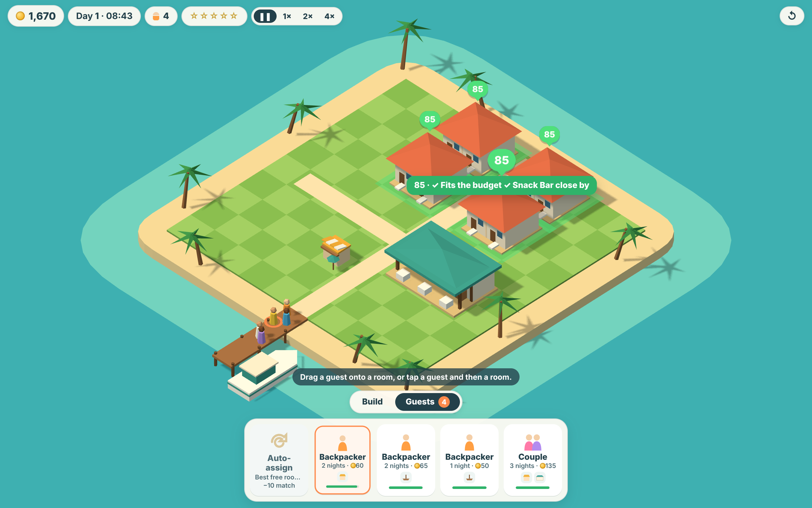

# Island Resort Tycoon (prototype)

A premium mobile tycoon game: grow a tiny island into a five-star resort, check guests in by
hand, and watch them walk your paths and spend money.

This repository holds the proof of concept. The plan is in [docs/ROADMAP.md](docs/ROADMAP.md).
**M1–M5 are done:** island and construction, clock and ferry, check-in, needs and spending, and the nightly accounts, reviews and star rating. Pass 1 (depth) is done: a bigger island with land plots, tier-1 and tier-2 buildings, research, six guest types, stacked floors, and scenario 1 with medals, daily goals and an investor rescue; see [docs/CATALOGUE.md](docs/CATALOGUE.md). Then come the balance and graphics/GUI passes.
Play it on GitHub Pages: https://fortisross14-pixel.github.io/island-resort-tycoon/



## Run it

```sh
npm install
npm run dev        # http://localhost:5173, also reachable from a phone on the same network
npm test           # simulation rules (Vitest)
npm run build      # type-check and build to dist/
```

## Controls

| Action | Touch | Mouse / keyboard |
|---|---|---|
| Pan | one finger (no tool selected), or two fingers | drag, or right/middle-drag with a tool |
| Zoom | pinch | wheel |
| Draw paths | pick **Footpath**, drag from an existing path | `1`, then drag |
| Build | **Build** in the dock, pick a category, then drag a card onto the map or tap it and tap the map | `2`–`9`, then click |
| Rotate | **Rotate** | `R` |
| Demolish (50% refund) | **Demolish**, then tap | `X`, then click |
| Undo (full refund) | **Undo** | `Ctrl/Cmd+Z` |
| Leave the tool | **Done** | `Esc` |
| Pause / speed | the round button in the dock; the 1×/2×/4× chip next to the clock | `Space` pauses |
| Check in a guest | **Guests** in the dock: drag a card onto a room, or tap a card then a room | same; `G` toggles the sheet |
| Building details | the ⓘ on a card, or long-press the card | Tab to a card, `I` |
| Sound, reduce motion, new island | the ••• menu | |

Tap a guest or a building with no tool selected to open its panel. A venue's panel sets its price; a room's panel sets the nightly rate. At 23:00 the night report appears: tap a review to see where it happened, then **Start day** (or Enter).

## Layout

```
src/
  sim/        pure game rules, with no DOM or Three.js; unit tested
    buildings.ts   catalogue, costs, footprints
    world.ts       grid, paths, buildings, placement rules, snapshots
    history.ts     undo
    pathGraph.ts   cached walking distances over the footpaths
    sim.ts         clock, ferry, check-in queue and guest agents (fixed tick)
    match.ts       room match score: budget tier and wishes
    needs.ts       meters, venues, price steps, room rates
    reviews.ts     review lines, stars and the rating
    rng.ts         seeded RNG
  render/     Three.js
    stage.ts       renderer, ortho camera, picking, pan/zoom, render-on-demand
    models.ts      low-poly building, palm and path models
    worldView.ts   keeps the scene in sync with the World; ghosts and highlights
    guestView.ts   instanced guests and the ferry
    coinPops.ts    floating +N coins on purchases
  ui/hud.ts   DOM overlay (Lagoon Glass): top chips, dock, build/guest/research sheet, toasts
  ui/sfx.ts   synthesized sound effects (WebAudio)
  ui/panel.ts guest and building info panel
  ui/report.ts night report
  game.ts     input handling and tools; glues sim, render and UI
tests/        Vitest specs for the sim
```

In the browser console, `game.world` and `game.sim` give you the live simulation.

## Deploy

Every push to the default branch builds, tests and publishes to GitHub Pages through
`.github/workflows/deploy.yml`. One-time setup: **Settings → Pages → Source: GitHub Actions**.
