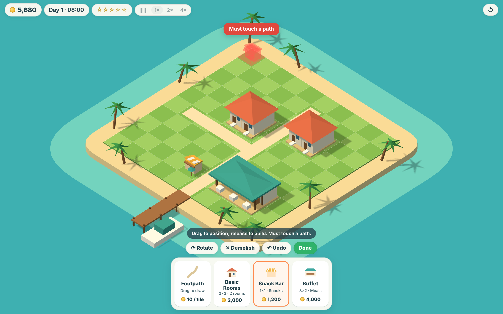

# Island Resort Tycoon (prototype)

A premium mobile tycoon game: grow a tiny island into a five-star resort, check guests in by
hand, and watch them walk your paths and spend money.

This repository holds the proof of concept. The plan is in [docs/ROADMAP.md](docs/ROADMAP.md).
**M1 (island and construction) is done.**



## Run it

```sh
npm install
npm run dev        # http://localhost:5173, also reachable from a phone on the same network
npm test           # simulation rules (Vitest)
npm run build      # type-check and build to dist/
```

## Controls

| Action | Touch | Mouse / keyboard |
|---|---|---|
| Pan | one finger (no tool selected), or two fingers | drag, or right/middle-drag with a tool |
| Zoom | pinch | wheel |
| Draw paths | pick **Footpath**, drag from an existing path | `1`, then drag |
| Build | drag a card onto the map, or pick it and tap | `2`–`4`, then click |
| Rotate | **Rotate** | `R` |
| Demolish (50% refund) | **Demolish**, then tap | `X`, then click |
| Undo (full refund) | **Undo** | `Ctrl/Cmd+Z` |
| Leave the tool | **Done** | `Esc` |

Tap a building with no tool selected to see what it is.

## Layout

```
src/
  sim/        pure game rules, with no DOM or Three.js; unit tested
    buildings.ts   catalogue, costs, footprints
    world.ts       grid, paths, buildings, placement rules, snapshots
    history.ts     undo
  render/     Three.js
    stage.ts       renderer, ortho camera, picking, pan/zoom, render-on-demand
    models.ts      low-poly building, palm and path models
    worldView.ts   keeps the scene in sync with the World; ghosts and highlights
  ui/hud.ts   DOM overlay: top bar, build tray, toolbar, toasts
  game.ts     input handling and tools; glues sim, render and UI
tests/        Vitest specs for the sim
```

In the browser console, `game.world` gives you the live simulation.
